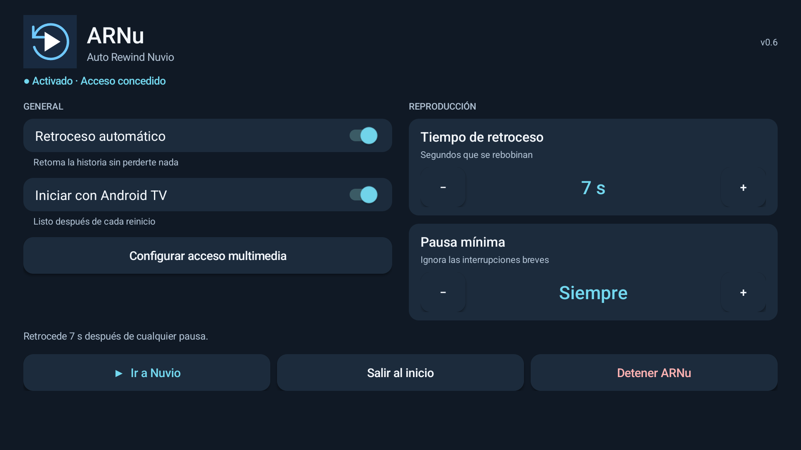
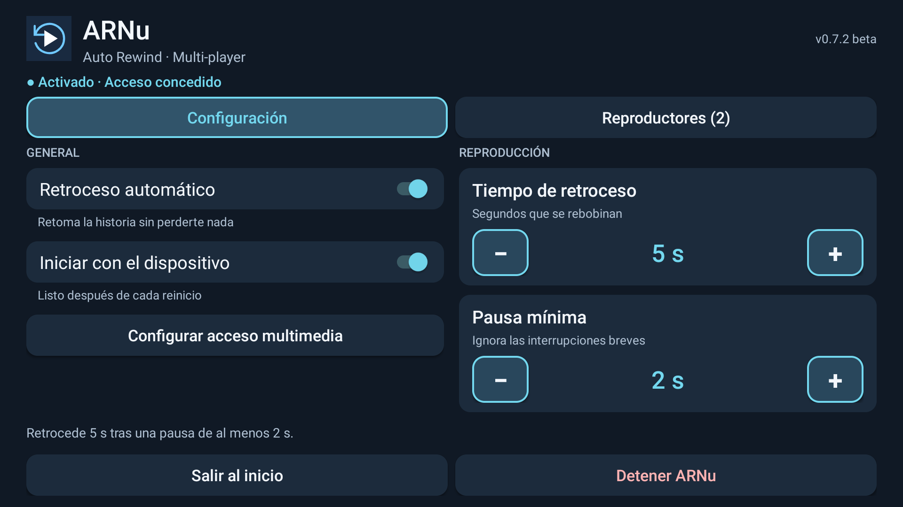
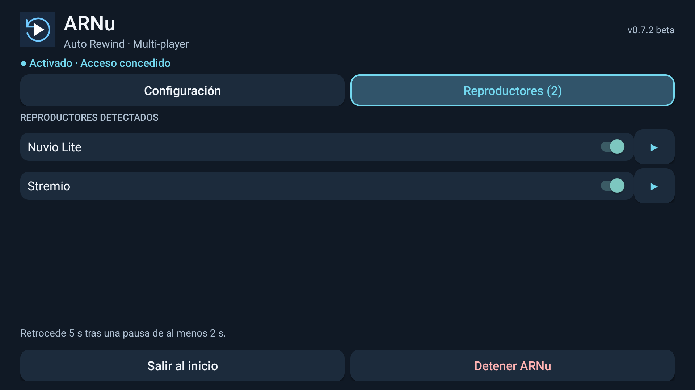

# ARNu — Auto Rewind Nuvio

[](https://github.com/usertion/ARNu/releases) [](LICENSE) [](https://github.com/usertion/ARNu/releases)

**[⬇ Descargar ARNu / Download ARNu (APK)](https://github.com/usertion/ARNu/releases/latest/download/ARNu.apk)** · [Última versión / Latest release](https://github.com/usertion/ARNu/releases/latest)

<div align="center">



**ARNu 0.6 · Auto Rewind Nuvio**

</div>

**ARNu** is a lightweight, independent companion app for **Nuvio on Android TV**. It automatically rewinds playback when you resume after a pause, so you don't miss the dialogue or action.

**Stable channel:** 0.6 · **Experimental beta:** 0.7.2.

[Español](#español) · [English](#english) · [Build](#build-from-source) · [License](LICENSE)

## Multi-player beta — 0.7.2

**[Descargas beta / Beta downloads](https://github.com/usertion/ARNu/releases)** · [Experimental branch / Rama experimental](https://github.com/usertion/ARNu/tree/experimental-0.7)

**Español:** La beta amplía ARNu a Nuvio, Nuvio Lite, Stremio y Nuvio Arc (compatibilidad experimental). Detecta los reproductores compatibles instalados, permite activar el retroceso por aplicación y abrir cada reproductor. La interfaz tiene dos pestañas: Configuración y Reproductores. «Detener ARNu» detiene el servicio sin cambiar las preferencias; al abrir ARNu se recupera la configuración. Nuvio Lite y Stremio han sido probados en Fire TV Stick 4K Max (Fire OS 7); Nuvio Arc está pendiente de validación.

**English:** The beta adds experimental multi-player support for Nuvio, Nuvio Lite, Stremio and Nuvio Arc, automatic detection of installed supported players, individual switches and launch buttons, and Settings and Players tabs. Stop ARNu disconnects the service without changing preferences. Nuvio Lite and Stremio have been tested on Fire TV Stick 4K Max (Fire OS 7); Nuvio Arc remains unverified.

<div align="center">


</div>

**Fire OS 7:** Si no se abre el ajuste de acceso multimedia / If media access settings cannot be opened, use ADB on your own device:

```sh
adb shell cmd notification allow_listener org.arnu.diagnostic/org.arnu.diagnostic.SessionListener
```

Omitir `adb shell` si ya estás en la consola / Omit `adb shell` if already in the shell.

## Español

ARNu retrocede automáticamente unos segundos al reanudar un vídeo en **Nuvio**. Funciona en segundo plano, sin modificar Nuvio ni instalar complementos en su interior.

### Funciones

- Retroceso configurable de **1 a 30 segundos**.
- **Pausa mínima** configurable de **0 a 120 segundos**: si la interrupción dura menos, no retrocede. El valor 0 significa que retrocede después de cualquier pausa.
- Interruptor para activar o desactivar el retroceso.
- Opción de inicio automático con Android TV.
- Botones **Ir a Nuvio**, **Salir al inicio** y **Detener ARNu**.
- Interfaz para televisión, manejable con el mando, en español e inglés.
- Ajustes persistentes y funcionamiento en segundo plano.

### Instalación y configuración

1. Descarga el APK desde [Releases](https://github.com/usertion/ARNu/releases) **cuando haya una versión publicada**. Hasta entonces, las compilaciones de prueba se encuentran en [Actions](https://github.com/usertion/ARNu/actions) → ejecución correcta → **Artifacts** (el APK está dentro de un ZIP).
2. Instala el APK en tu dispositivo Android TV. Puede ser necesario autorizar la instalación desde la aplicación que utilices para abrirlo.
3. Abre **ARNu** y pulsa **Configurar acceso multimedia**. Android mostrará el ajuste de *Acceso a notificaciones*: autoriza ARNu. Este permiso permite acceder a las sesiones multimedia activas; ARNu no necesita leer el texto de tus notificaciones.
4. Activa **Retroceso automático** y ajusta el tiempo de retroceso y la pausa mínima.
5. Opcionalmente, activa **Iniciar con Android TV**.
6. Pulsa **Ir a Nuvio** y prueba a pausar y reanudar un vídeo.

**Ejemplo:** retroceso de 7 s y pausa mínima de 15 s: una pausa de 3 s no provoca retroceso; una de 30 s sí.

**Botones de salida:** «Ir a Nuvio» y «Salir al inicio» cierran la pantalla de configuración, pero mantienen activo el retroceso. «Detener ARNu» desactiva el retroceso hasta que vuelvas a activarlo. Android puede conservar el servicio autorizado en memoria aunque esté desactivado.

### Compatibilidad y limitaciones

- Requiere Android **8.0 (API 26)** o superior; está diseñado para Android TV.
- Necesita Nuvio instalado y una sesión multimedia activa que permita desplazamientos (*seek*).
- El comportamiento puede variar según el dispositivo, la versión de Nuvio y el reproductor utilizado.
- El arranque automático depende de que el sistema permita ejecutar el receptor de inicio y conectar el servicio autorizado.
- ARNu no garantiza que Android nunca cierre su proceso. La optimización de batería del fabricante puede afectar al funcionamiento.
- **Versión beta:** probada inicialmente en un Tanix TX5 con Android 14. No se ha validado todavía en todos los dispositivos.


### Dispositivos probados

| Dispositivo | Sistema | Resultado |
|---|---|---|
| Tanix TX5 | Android 14 | Funcionamiento confirmado |
| TCL C765 | Google TV 14 | Funcionamiento confirmado |
| Xiaomi Mi Box 3 Gen | Google TV 14 | Funcionamiento confirmado |
| Amazon Fire TV Stick 4K Max (1.ª generación, 2021) | Fire OS 7.7.1.3 (Android 9) | Nuvio Lite y Stremio: retroceso confirmado en rama 0.7 beta; permiso mediante ADB; interfaz 0.7.2 probada |
| Fire TV Stick 4K Plus | Fire OS | Instalación y permisos sin ADB confirmados; retroceso con Nuvio Lite pendiente |

### Android 13/14: «Ajuste restringido» y permiso de acceso multimedia

En algunos dispositivos con Android 13 o 14, las aplicaciones instaladas mediante APK pueden mostrar **«Ajuste restringido»** al intentar habilitar el acceso a notificaciones. El permiso es necesario para que ARNu pueda detectar la pausa y controlar la sesión multimedia de Nuvio. No es lo mismo que el interruptor ordinario de **«Notificaciones»** de la ficha de la aplicación: ese controla las notificaciones que ARNu puede mostrar, no el acceso a sesiones multimedia.

**Primero prueba sin ADB:** abre la ficha de ARNu en Ajustes → Aplicaciones y, si existe el menú de tres puntos, elige **«Permitir ajustes restringidos»**. Después vuelve a ARNu → **Configurar acceso multimedia** y autoriza el acceso.

**Si esa opción no existe**, en un dispositivo propio y de confianza se puede probar mediante ADB (requiere depuración habilitada y conexión ADB desde un ordenador o una herramienta como ATVTools):

```sh
adb shell appops set org.arnu.diagnostic ACCESS_RESTRICTED_SETTINGS allow
adb shell appops get org.arnu.diagnostic ACCESS_RESTRICTED_SETTINGS
```

El segundo comando debería indicar `ACCESS_RESTRICTED_SETTINGS: allow`. Si ya estás dentro de una consola `adb shell` (por ejemplo, en ATVTools), **omite** el prefijo `adb shell` y ejecuta directamente `appops set ...` y `appops get ...`.

**Importante:** este comando **no concede por sí mismo** el acceso a notificaciones. Después abre ARNu, pulsa **Configurar acceso multimedia**, activa manualmente el permiso de ARNu en Android y vuelve a la app para encender **Retroceso automático**. Verifica que la cabecera indique **Activado**. «Iniciar con Android TV» por sí solo no activa el retroceso.

El procedimiento ADB se ha probado en **Tanix TX5 con Android 14**; no se garantiza en otros firmwares. Puede devolver errores o estar bloqueado por el fabricante. **No hace falta root**. Utiliza ADB solo en dispositivos que administras y comprende que estás levantando una protección de Android para esta aplicación concreta. ARNu no puede concederse automáticamente ese permiso.

### Privacidad

ARNu no requiere permiso de Internet, acceso a archivos ni permisos de root. Utiliza el acceso a notificaciones de Android para obtener las **sesiones multimedia activas**, detectar el estado de reproducción de Nuvio y solicitar el retroceso. El código no procesa el contenido de las notificaciones ni incorpora analítica o publicidad.

### Problemas conocidos / diagnóstico

- Si no funciona, comprueba que el acceso a notificaciones de ARNu está autorizado y que el retroceso automático está activado.
- Si la pausa es inferior al mínimo configurado, **no debe** retroceder.
- Si Nuvio cambia de contenido o de posición durante la pausa, ARNu puede omitir el retroceso para evitar un salto incorrecto.
- Para diagnóstico mediante ADB: `adb logcat -s ARNu`.
- Las compilaciones **debug** de GitHub Actions pueden tener firmas diferentes. Si Android rechaza la actualización, no desinstales sin antes tener en cuenta que perderás los datos y permisos de la app. Las versiones públicas deben firmarse siempre con la misma clave.

## English

ARNu is an independent Android TV companion app for Nuvio. It rewinds playback when you resume after a pause, helping you catch what you missed.

**Features:** adjustable rewind (1–30 s), minimum pause threshold (0–120 s; 0 = always), enable/disable switch, start on boot, TV-friendly remote controls, persistent preferences, background operation, and actions to open Nuvio, return home or disable ARNu.

**Setup:** install the APK, open ARNu, grant notification listener access under Android settings, enable automatic rewind, configure both times and select **Go to Nuvio**. The permission is used to access active media sessions; ARNu does not process notification text.

**Compatibility:** Android 8.0+; designed for Android TV and Nuvio. Functionality depends on device firmware, media-session support and battery-management behavior. This is beta software.


### Tested devices

| Device | OS | Result |
|---|---|---|
| Tanix TX5 | Android 14 | Confirmed working |
| TCL C765 | Google TV 14 | Confirmed working |
| Xiaomi Mi Box 3 Gen | Google TV 14 | Confirmed working |
| Amazon Fire TV Stick 4K Max (1st generation, 2021) | Fire OS 7.7.1.3 (Android 9) | Nuvio Lite and Stremio: rewind confirmed on 0.7 beta branch; permission via ADB; 0.7.2 UI tested |
| Fire TV Stick 4K Plus | Fire OS | Installation and permissions confirmed without ADB; rewind with Nuvio Lite not yet verified |

### Android 13/14: restricted settings

On some Android 13/14 devices, a sideloaded APK cannot enable notification listener access and Android shows **“Restricted setting”**. This is different from the ordinary **Notifications** toggle in the app's system settings, which controls notifications displayed by the app.

First, check ARNu's system app-info page for a three-dot menu → **Allow restricted settings**. If present, enable it, then return to ARNu → **Configure media access** and manually enable notification access.

If the option is missing, advanced users may try ADB on a device they own:

```sh
adb shell appops set org.arnu.diagnostic ACCESS_RESTRICTED_SETTINGS allow
adb shell appops get org.arnu.diagnostic ACCESS_RESTRICTED_SETTINGS
```

If already inside `adb shell`, omit the `adb shell` prefix. The expected check result is `ACCESS_RESTRICTED_SETTINGS: allow`.

**ADB does not grant notification listener access automatically.** Open ARNu → **Configure media access**, manually authorize ARNu in Android settings, then enable **Automatic rewind** in ARNu and confirm its status is **Enabled**. Start on boot alone does not enable rewind.

This workaround was tested on a **Tanix TX5 running Android 14**. Other devices may behave differently or reject the command. No root is required. ADB lifts a security restriction for ARNu; use it only on trusted devices and applications.

**Privacy:** no Internet, storage or root permission; no telemetry or advertising. See the source code for details.

**Troubleshooting:** `adb logcat -s ARNu`. A pause shorter than the configured threshold does not trigger rewind.

## Build from source

Requires JDK 17, Android SDK Platform 35, Android Build Tools 35.0.0 and Gradle 8.9.

```bash
gradle --no-daemon assembleDebug
```

Output: `app/build/outputs/apk/debug/app-debug.apk`.

The [GitHub Actions workflow](.github/workflows/build-apk.yml) builds a **debug** APK and, when release signing secrets are configured, a **signed release** APK; both are uploaded as ZIP artifacts. **Do not treat this as a stable public update channel:** debug signatures may change between builds.

For public releases, securely retain the **permanent release signing key**, and attach the signed APK directly to a GitHub Release. Never commit the private signing key or its passwords to the repository.

## License

[MIT License](LICENSE). ARNu is an independent community project and is not affiliated with Nuvio.
